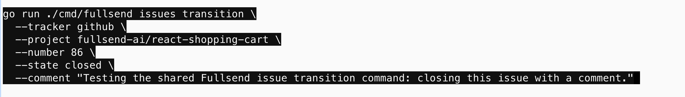
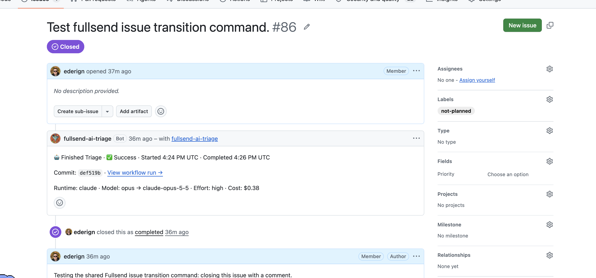
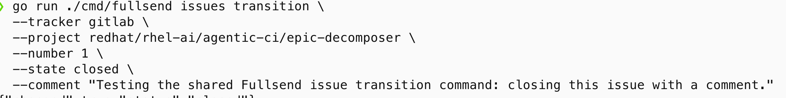
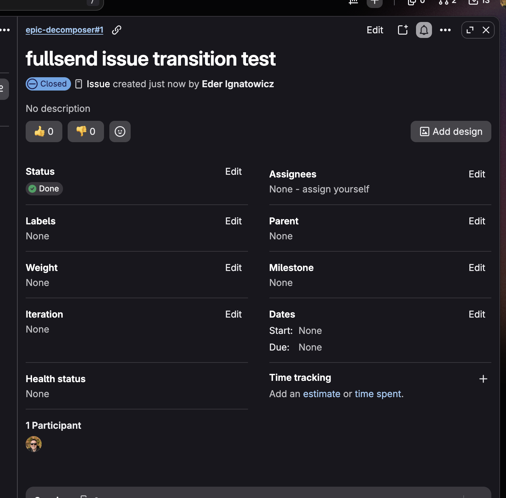
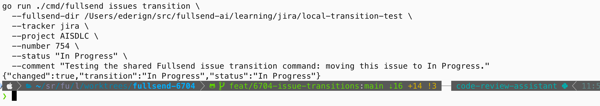
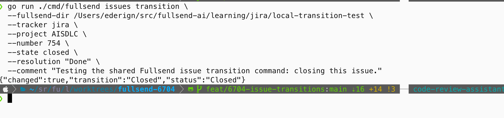
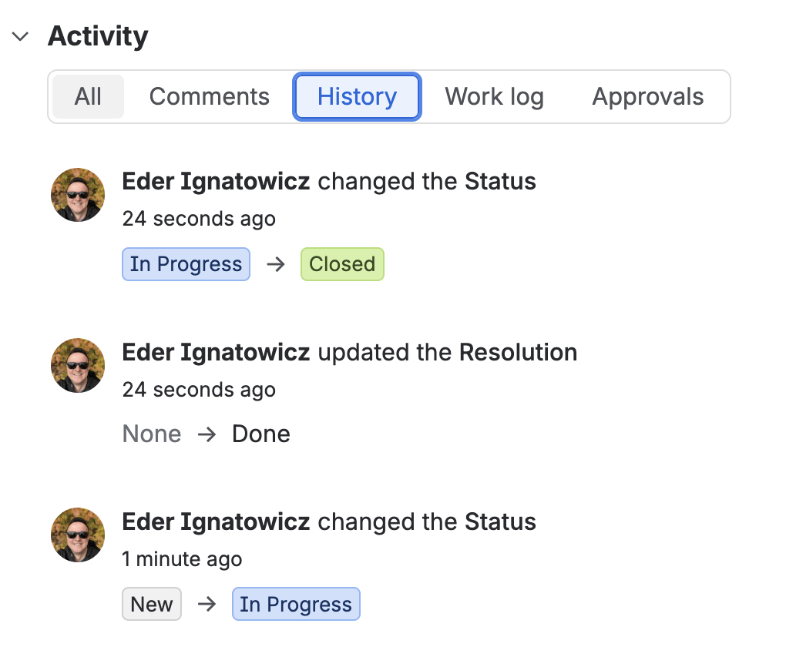
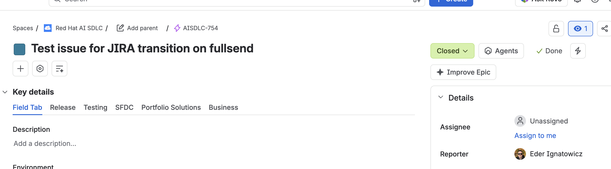

# PR 9437 — manual live CLI evidence

Screenshots supplied by Eder on November 13, 2026, paired without altering their contents. This evidence covers direct CLI invocation, not automated code-agent hooks or a dedicated service account.

## GitHub: close and comment

## GitLab: close with a requested comment

The screenshot confirms closure; the comment is not visible.

## Jira: New → In Progress → Closed

The Jira commands include comments, but the screenshots do not show the comment stream. The initial close attempt without required resolution was rejected; supplying Done succeeded.

Open index.html locally for the self-contained evidence page with embedded screenshots.
